<div align="center">

<a href="https://vac-eastern-university.vercel.app">
  
</a>

<br/>

### A living archive for the next generation of visual storytellers.

<sub>EST. 2010 &nbsp; • &nbsp; EASTERN UNIVERSITY &nbsp; • &nbsp; DHAKA, BANGLADESH</sub>

<br/><br/>

[**Enter the VAC experience ↗**](https://vac-eastern-university.vercel.app) &nbsp;·&nbsp;
[**Discover the archive ↗**](https://vac-eastern-university.vercel.app/archive) &nbsp;·&nbsp;
[**Meet the people ↗**](https://vac-eastern-university.vercel.app/#committee) &nbsp;·&nbsp;
[**Become a member ↗**](https://vac-eastern-university.vercel.app/join)

<br/><br/>

[](https://github.com/rzprince/VAC-Eastern-University-Website/actions/workflows/ci.yml)


[](./LICENSE)

</div>

<br/>

## ✦ The story behind the frame

> **Visual Archive Club (VAC) is a club for creative minds.**

From photography and filmmaking to videography and content creation, we bring ideas to life through visuals and stories.

Since **2010**, VAC has been a place to **learn, create, experiment, and inspire**.

We believe that a photograph can preserve a feeling. A film can spark a conversation. An exhibition can change how somebody sees the world. The VAC website is where those moments meet a community and become a growing visual record of Eastern University.

<br/>


<br/>

## Designed like a studio. Built for a community.

This is more than a club landing page. It combines a cinematic, editorial experience with the tools a student-led creative organization needs to keep its work alive across committees and years.

<table>
<tr>
<td width="50%" valign="top">

**01 / The first impression**

- Editorial type and photographic storytelling
- Midnight tones with VAC's signature orange
- Motion, depth and soft light
- Responsive layouts for small screens and large displays

</td>
<td width="50%" valign="top">

**02 / A home for the work**

- Photography and moving-image gallery
- Events, artwork and announcements
- Video thumbnails linking to their original Facebook posts
- Living archive designed to grow over time

</td>
</tr>
<tr>
<td valign="top">

**03 / The people behind it**

- Committee profiles and creative roles
- President's featured profile
- Club updates and community links
- Branded membership journey

</td>
<td valign="top">

**04 / The tools behind the scenes**

- Content management for authorized club editors
- Data-backed membership applications
- Document receipts for submitted applications
- A structured system for future committees

</td>
</tr>
</table>

<details>
<summary><strong>What makes the interface feel different?</strong></summary>

<br/>

The design system borrows the visual language of a studio rather than a traditional administration portal: confident negative space, art-directed imagery, expressive display typography and intentional interaction. Animation serves the story, not the other way around.

Motion is an enhancement, not a dependency. Content remains accessible without animation, and the site supports reduced-motion preferences.

</details>

## Built with modern web tools

<div align="center">

| Creative layer | Technology |
| :--- | :--- |
| **Application experience** | Next.js App Router, React, TypeScript |
| **Design & interaction** | Custom CSS, responsive layouts, progressive motion |
| **Data platform** | Supabase PostgreSQL, Auth and Storage |
| **Membership documents** | PDF generation in the application backend |
| **Deployment** | Vercel and GitHub Actions |

</div>

Our goal is a maintainable project that a future VAC committee can extend as confidently as today's.

## A closer look

<div align="center">

<a href="https://vac-eastern-university.vercel.app"><b>Explore the homepage</b></a>
&nbsp;&nbsp; ✧ &nbsp;&nbsp;
<a href="https://vac-eastern-university.vercel.app/events"><b>What's happening</b></a>
&nbsp;&nbsp; ✧ &nbsp;&nbsp;
<a href="https://vac-eastern-university.vercel.app/archive"><b>Visual archive</b></a>

<br/><br/>

<sub>New committee portraits, original gallery work and future event banners will make the experience even richer as VAC publishes them.</sub>

</div>

## Start developing

You'll need a supported Node.js release, npm and a Supabase project. The repository provides an **empty environment-variable template**, not deployment credentials.

```bash
git clone https://github.com/rzprince/VAC-Eastern-University-Website.git
cd VAC-Eastern-University-Website
npm install
cp .env.example .env.local
npm run dev
```

Configure your *own* backend settings in `.env.local`. This file is excluded from Git. Database migrations are maintained in `supabase/migrations`; use a new development project rather than an existing live membership database.

To verify changes:

```bash
npm run security:test
npm run security:public
npm run security:audit
npx tsc --noEmit
npm run build
```

<details>
<summary><strong>Repository structure</strong></summary>

```text
app/             Pages, app layouts and application endpoints
components/      Reusable UI and interactive experiences
lib/             Data access and server-side functionality
public/          VAC and Eastern University design assets
docs/            Visuals and project documentation
supabase/        Database migrations and server functions
tests/           Automated quality checks
```

</details>

### Contributing

Thoughtful contributions are welcome. For a new feature or visual change, open an issue or pull request describing the intention and showing before/after screenshots where useful. Keep changes accessible, mobile-friendly and consistent with the existing VAC identity.

Never add personal membership records, credentials, private keys, application PDFs or other confidential material to commits, issues or pull requests. Use sample data for demonstrations.

## From one committee to the next

A new photographer brings a set of unforgettable frames. A filmmaker shares a story. An artist prepares an exhibition. A future committee carries them forward. **The archive gets better because the people keep creating.**

<br/>

---

<div align="center">


&nbsp;&nbsp;&nbsp;&nbsp;


### WHERE EVERY FRAME BECOMES HISTORY.

**Visual Archive Club** &nbsp; · &nbsp; **Eastern University** &nbsp; · &nbsp; **Since 2010**

<br/>

[Official VAC Facebook Page ↗](https://www.facebook.com/visualarchiveeu) &nbsp;·&nbsp;
[VAC Facebook Community ↗](https://www.facebook.com/groups/603306963175089)

<br/>

Designed and developed by **[Rezwan Hossain Prince](https://www.facebook.com/rz.hs.prince)**

<br/>

<sub>Created for the people who capture, create and remember.</sub>

<sub>The source code is MIT-licensed. VAC and Eastern University branding remains the property of its respective rights holders.</sub>

</div>
