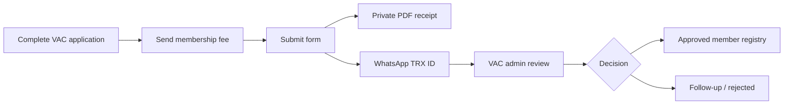

<div align="center">


<br/>

**An expressive digital home for the people who see stories in every frame.**

<br/>

[**Explore the live website ↗**](https://vac-eastern-university.vercel.app) &nbsp;·&nbsp;
[**Meet the committee**](https://vac-eastern-university.vercel.app/#committee) &nbsp;·&nbsp;
[**Join VAC**](https://vac-eastern-university.vercel.app/join)

<br/>

[](https://github.com/rzprince/VAC-Eastern-University-Website/actions/workflows/ci.yml)


[](./LICENSE)

</div>

---

## A club built around the art of seeing

Visual Archive Club (VAC) is a club for creative minds at **Eastern University, Bangladesh**.

From photography and filmmaking to videography and content creation, we bring ideas to life through visuals and stories. Since 2010, VAC has been a place to **learn, create, experiment, and inspire**.

This website is an extension of that idea. It is part portfolio, part living archive, and part operating system for a student creative community. The experience feels like a visual studio, while the tools behind it help each new committee preserve and carry forward what the previous one created.

**The vision:** Photography · Videography · Content Creation · Storytelling · Filmmaking · Art Exhibitions · Digital Art.

## Designed to feel like VAC

The interface takes its cues from the work of photographers and filmmakers, not from a conventional university administration portal.

| Design decision | Why it matters |
| :--- | :--- |
| **Editorial typography** | A strong contrast between cinematic display lettering and readable body text. |
| **Midnight surfaces, warm orange light** | A focused palette that makes photographs and stories the priority. |
| **Photography-first layouts** | Image-led creative disciplines, event covers, archive previews and member portraits. |
| **Purposeful interaction** | Small depth cues, animated highlights, smooth feedback and prominent actions without distracting from content. |
| **Mobile-first refinements** | Responsive navigation, legible application fields and layouts that work beyond desktop. |
| **Motion with restraint** | Subtle animations are enhancements; content remains usable without them and reduced-motion preferences are respected. |

> A design-led website is only useful when it is equally thoughtful about the people who maintain it.

## What the platform does

### For visitors

- **Discover VAC.** Explore the club's story, creative disciplines, committee and current announcements.
- **Meet the people behind the camera.** View committee profiles, with a featured President profile and clickable public contact details.
- **Stay close to the work.** Browse upcoming events, live countdowns, recent activities, photos and the filterable visual archive.
- **Watch the stories.** Video thumbnails take visitors directly to the corresponding VAC Facebook video or post.
- **Become a member.** Complete the branded application on desktop or mobile and download a personalized membership PDF.

### For the committee

The authenticated admin workspace makes routine club updates possible without editing source code: update public club information, manage committee profiles and photographs, publish announcements, schedule events and posters, and upload gallery images or Facebook video thumbnails.

Applications can be reviewed with payment information, internal notes and status changes. Approved applicants can be organized in a member registry, and authorized admins can export records when needed.

**Admin workspace:** [VAC Admin Login](https://vac-eastern-university.vercel.app/admin/login)

## Membership, from form to archive

The joining process is intentionally straightforward. Applicants submit their university and contact information, creative interests, and reason for joining. The current fee is **৳150**, paid via bKash Send Money. After submitting the application, a WhatsApp chat opens so the applicant can provide the transaction ID for **manual review**.

The system generates a **branded single-page PDF application receipt**, including the VAC and Eastern University marks, applicant information, creative profile, payment details and a President acknowledgement. It remains **pending verification** until a VAC administrator checks the transaction; the PDF itself is not proof of approved membership or confirmed payment.



Application PDFs are saved to **private Supabase Storage** and can be retrieved through protected application links. Optional Google Drive synchronization is supported in the server code but needs **separate service-account credentials and folder permissions**. A connected ChatGPT account does not, by itself, enable uploads from Vercel.

## Under the hood

| Layer | Technology |
| :--- | :--- |
| Experience | Next.js App Router, React, TypeScript, CSS |
| Data and access | Supabase PostgreSQL, Auth, Row Level Security |
| Media and application PDFs | Supabase Storage |
| Documents | pdf-lib and Sharp |
| Hosting | Vercel |
| Quality checks | GitHub Actions, TypeScript, security regression tests, dependency audit |

The site separates its public reading experience from protected administrative actions. Supabase policies protect private applicant records; the API validates submissions and uses signed storage paths and private download access. Security is a continuing engineering responsibility, not a label or a substitute for independent testing.

<details>
<summary><strong>Project layout</strong></summary>

```text
app/
  page.tsx                Home and public VAC experience
  join/                   Membership application
  events/                 Events and announcements
  archive/                Media archive
  admin/                  Protected committee workspace
  api/                    Registration and document endpoints
components/               Reusable experience and form components
lib/                      Site data, Supabase, PDF and security logic
supabase/
  migrations/             Versioned database changes
  functions/              Protected PDF retrieval function
tests/                    Security regression checks
docs/                     Operations, security and visual documentation
public/                   Club and university branding assets
```

</details>

## Run it locally

You will need **Node.js 22 or newer**, npm, and a Supabase project configured with the repository's database migrations.

```bash
git clone https://github.com/rzprince/VAC-Eastern-University-Website.git
cd VAC-Eastern-University-Website
npm install
cp .env.example .env.local
```

Fill in the Supabase project URL and publishable key in `.env.local`. Set a **private registration signing secret** for the server:

```bash
openssl rand -hex 32
```

Copy the resulting 64-character hexadecimal value into `VAC_REGISTRATION_SECRET` in `.env.local`. Never commit that value.

Apply the SQL migrations in `supabase/migrations/` **in numeric order (001–009)** to a *fresh* project. Configure an authorized Supabase Auth administrator and the necessary storage policies before accepting real applications. Existing databases should be migrated deliberately, not reset.

```bash
npm run dev
```

Open [localhost:3000](http://localhost:3000).

For a production-quality check:

```bash
npm run security:test
npm run security:audit
npx tsc --noEmit
npm run build
```

<details>
<summary><strong>Deployment and optional Drive integration</strong></summary>

Connect the repository to Vercel and configure the production environment variables documented in [`.env.example`](./.env.example). Public Supabase keys are intended for browser access; **server signing keys and Google credentials must never be exposed with a `NEXT_PUBLIC_` prefix**.

To synchronize application PDFs into a Google Drive folder, configure `GOOGLE_DRIVE_SERVICE_ACCOUNT_EMAIL`, `GOOGLE_DRIVE_PRIVATE_KEY` and `GOOGLE_DRIVE_FOLDER_ID`, then grant the service account appropriate access to the destination folder. Without these values, membership registration continues to use private Supabase Storage and the admin interface can report that Drive synchronization is unconfigured.

See [Admin Operations](./docs/ADMIN-OPERATIONS.md) and [Security Notes](./docs/SECURITY.md) for operational guidance.

</details>

## Keep the archive alive

The project is designed so the next committee can continue where the last one left off. A new photographer can upload an exhibition image. An event organizer can publish a poster and a countdown. An editor can connect a video thumbnail to the exact Facebook post. The club's visual history can grow without rebuilding the website for every tenure.

That continuity is the real purpose of VAC's digital home.

---

<div align="center">

**VISUAL ARCHIVE CLUB** · **EASTERN UNIVERSITY** · **EST. 2010**

Created and developed by **[Rezwan Hossain Prince](https://www.facebook.com/rz.hs.prince)**

[Website](https://vac-eastern-university.vercel.app) · [VAC Facebook Page](https://www.facebook.com/visualarchiveeu) · [VAC Community](https://www.facebook.com/groups/603306963175089)

<sub>Made for the people who create, capture and remember.</sub>

<sub>Source code: [MIT License](./LICENSE). VAC and Eastern University brand artwork remains associated with its respective owners.</sub>

</div>
