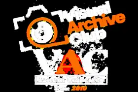

<div align="center">

<a href="https://vac-eastern-university.vercel.app" title="Enter the official VAC website">
  
</a>

<br />


&nbsp;&nbsp;&nbsp;&nbsp;


<br />

<h2>Not just a website. A universe of visual stories.</h2>

<strong>VISUAL ARCHIVE CLUB</strong> &nbsp; ✦ &nbsp; <strong>EASTERN UNIVERSITY</strong> &nbsp; ✦ &nbsp; <strong>EST. 2010</strong>

<br /><br />

<em>Where every frame becomes history.</em>

<br /><br />

<a href="https://vac-eastern-university.vercel.app" title="Enter the official VAC website">
</a>
&nbsp;
<a href="https://vac-eastern-university.vercel.app/join" title="Official VAC membership">
</a>

<br /><br />

<sub>A cinematic digital home for the creative minds of Eastern University, Dhaka, Bangladesh.</sub>

</div>

---

### THE STORY BEHIND THE FRAME

> **Visual Archive Club (VAC) is a club for creative minds.**

From photography and filmmaking to videography and content creation, we bring ideas to life through visuals and stories.

Since **2010**, VAC has been a place to **learn, create, experiment, and inspire**.

VAC is a home for people who notice the unnoticed: a fleeting expression, a carefully composed image, an unforgettable sequence, an idea waiting to become art. Each project contributes something larger than itself. Together, these moments form a growing creative memory of **Eastern University**.

A club's work deserves more than a temporary announcement or a forgotten folder. This space gives it a presence, a story and a future.

<br />

<div align="center">


<br />

<strong>PHOTOGRAPHY &nbsp; · &nbsp; VIDEOGRAPHY &nbsp; · &nbsp; CONTENT CREATION &nbsp; · &nbsp; STORYTELLING</strong>

<strong>FILMMAKING &nbsp; · &nbsp; ART EXHIBITIONS &nbsp; · &nbsp; DIGITAL ART</strong>
</div>

---

### THE EXPERIENCE IS THE IDENTITY

<div align="center">

**CINEMATIC DEPTH &nbsp; · &nbsp; EDITORIAL MINIMALISM &nbsp; · &nbsp; HUMAN-CENTERED INTERACTION**

</div>

The VAC experience brings the visual language of a professional creative studio into a university club. Layered photography, rich midnight tones, warm orange highlights, dramatic editorial typography and **3D-inspired, pointer-responsive depth** make the first impression unmistakably VAC.

Every glow, reveal, highlight, motion accent and transition has a purpose. Movement brings life to the story without getting in the way of it. Navigation stays clear, reading remains comfortable and layouts adapt from **mobile screens to wide desktop displays**. Visitors who prefer reduced motion can experience the same content without unnecessary animation.

The interface does not exist to show off effects. It exists to make creative work, people and moments worth exploring.

<br />

<table>
<tr>
<td width="50%" valign="top">

#### ◈ THE PEOPLE

**The faces behind the frames.**

A committee experience designed around the people who build VAC. Distinct member profiles, portraits, positions and contact details make the organization feel present and approachable, with its President featured as part of the club's story.

</td>
<td width="50%" valign="top">

#### ◈ THE CREATIVE ARCHIVE

**A place for work that deserves to last.**

Photography, video thumbnails, memorable events and featured projects have a structured home. Video previews connect back to VAC's original Facebook posts so the work retains its context and community.

</td>
</tr>
<tr>
<td valign="top">

#### ◈ THE LIVING CALENDAR

**Stories still waiting to happen.**

Events, announcements, future activities, banners and countdowns bring campus life into focus. Today's activity becomes tomorrow's archive.

</td>
<td valign="top">

#### ◈ THE MEMBERSHIP JOURNEY

**A thoughtful welcome to a creative community.**

A branded digital application, membership information, downloadable PDF record and manual bKash payment verification through the official WhatsApp contact turn a paper form into a clear online experience.

</td>
</tr>
<tr>
<td valign="top">

#### ◈ THE CONTROL ROOM

**Built to keep evolving.**

An authenticated administration experience supports the maintenance of club information, committee profiles, events, media and membership applications without rebuilding the public website each time.

</td>
<td valign="top">

#### ◈ THE ENGINE BENEATH THE ART

**Creative expression with a real application behind it.**

The website pairs **Next.js, React and TypeScript** with **Supabase** for managed data, authentication and media, and **Vercel** for its live deployment. The visual identity and the operational foundation are designed to work together.

</td>
</tr>
</table>

---

### EXPLORE THE VAC WORLD

<div align="center">

<a href="https://vac-eastern-university.vercel.app/" title="VAC homepage">
</a>
&nbsp;
<a href="https://vac-eastern-university.vercel.app/archive" title="Photography and video archive">
</a>
&nbsp;
<a href="https://vac-eastern-university.vercel.app/events" title="Club events and announcements">
</a>

<br /><br />

<a href="https://vac-eastern-university.vercel.app/#committee" title="Meet the VAC committee">
</a>
&nbsp;
<a href="https://vac-eastern-university.vercel.app/join" title="Join VAC">
</a>

</div>

---

### PEOPLE MAKE THE LEGACY

<div align="center">

#### REZWAN HOSSAIN PRINCE

**President · Visual Archive Club, Eastern University**

**Website design, development and creative direction**

</div>

Created with the conviction that a university club's digital presence can feel as considered, cinematic and purposeful as the work of a professional visual studio.

The ambition is personal. The archive is collective. The value of VAC is in its photographers, filmmakers, artists, storytellers and future members. **Technology gives their creativity a lasting place to be seen.**

<div align="center">

<a href="https://www.facebook.com/rz.hs.prince" title="Rezwan Hossain Prince on Facebook">
</a>

</div>

---

### THE OFFICIAL COMMUNITY

The live website is the front door. The people and conversations behind it live in VAC's official spaces. Each destination below opens the genuine club resource.

<div align="center">

<a href="https://www.facebook.com/visualarchiveeu" title="Official VAC Facebook page">
</a>
&nbsp;
<a href="https://www.facebook.com/groups/603306963175089" title="VAC Facebook community group">
</a>
&nbsp;
<a href="mailto:vac.easternuni@gmail.com" title="Contact Visual Archive Club by email">
</a>

<br /><br />

<sub>Official contact: vac.easternuni@gmail.com &nbsp; · &nbsp; Eastern University, Bangladesh</sub>

</div>

---

### PROPRIETARY SOURCE & COPYRIGHT

<div align="center">

</div>

> **SOURCE-AVAILABLE FOR VIEWING ONLY. NOT OPEN SOURCE.**  
> Public visibility does **not** mean permission to reproduce, adapt, host, redistribute, sublicense or commercially exploit the website or its branding.

```text
Copyright (c) 2026 Rezwan Hossain Prince and Visual Archive Club, Eastern University.
All rights reserved.

This source code is published for viewing only. No permission is granted to copy,
modify, distribute, sublicense or deploy this code, or to use the VAC and
Eastern University names and branding, in whole or in part, without prior
written permission.
```

The original names, logos, identity and creative materials of **Visual Archive Club** and **Eastern University** must be respected. Written authorization must be obtained from the relevant rights holders before any proposed use. The [LICENSE](./LICENSE) contains the proprietary notice for this revision.

<sub>Historical licensing clarification: earlier versions of this repository were published under MIT terms. This notice does not retroactively cancel permissions already granted for those earlier versions.</sub>

---

<div align="center">


&nbsp;&nbsp;&nbsp;


<br />

### WHAT WE CREATE TODAY BECOMES THE STORY WE LEAVE BEHIND.

**Visual Archive Club &nbsp; · &nbsp; Eastern University &nbsp; · &nbsp; Since 2010**

<br />

<a href="https://vac-eastern-university.vercel.app" title="Open VAC official website">
</a>

<br /><br />

<sub>Developed by <a href="https://www.facebook.com/rz.hs.prince"><strong>Rezwan Hossain Prince</strong></a> · President, VAC</sub>

<br />

<sub>© 2026 Rezwan Hossain Prince and Visual Archive Club, Eastern University. All rights reserved.</sub>

<br />

**The frame ends. The story continues.**

</div>
